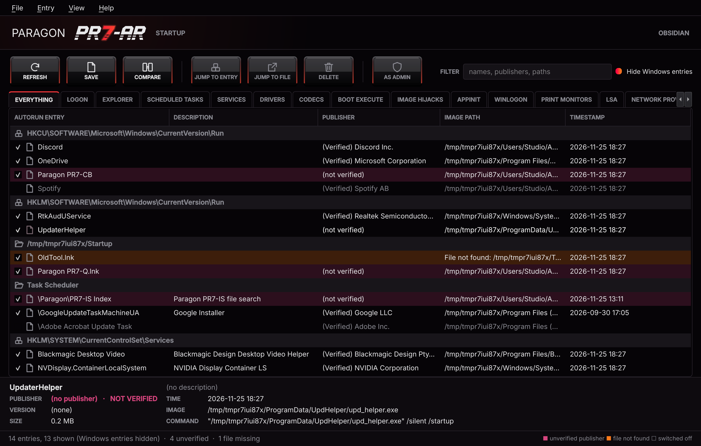
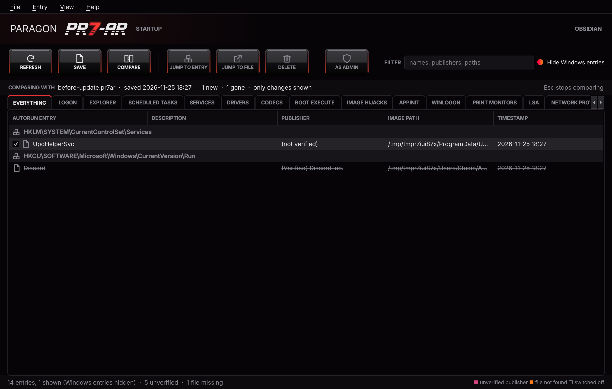

# Paragon PR7-AR

A startup manager that works the way **Autoruns** works, in the Paragon family look (PR7-Z, PR7-W, PR7-L, PR7-F,
PR7-E, PR7-R, PR7-P, PR7-M, PR7-Q, PR7-U, PR7-DU, PR7-CB, PR7-IS, PR7-PM, PR7-SM, PR7-HB, PR7-FS). Python and PySide6.

## What it does

- Everything Windows starts by itself, by tab: **Logon** (Run keys, Startup folders), **Explorer** (menu handlers,
  overlay icons), **Scheduled Tasks**, **Services**, **Drivers**, **Codecs**, **Boot Execute**, **Image Hijacks**,
  **AppInit**, **Winlogon**, **Print Monitors**, **LSA**, **Network Providers** and **Office** add-ins.
- Each entry shows its program file, description, publisher and time. Windows checks who signed the file (catalog
  signatures included), and nothing is sent online. **Unverified publishers are pink, missing files orange.**
  *Hide Windows entries* leaves Windows' own out.
- **Untick** an entry to switch it off without deleting it. It works the way Autoruns does, so either program sees
  what the other switched off:
  - registry values and keys move into an "AutorunsDisabled" key;
  - Startup items move into an "AutorunsDisabled" folder;
  - tasks are disabled;
  - services get Start = disabled.

  Windows' must-haves (userinit, explorer, autocheck) can't be switched off.
- **Delete** (asks first; Startup files go to the Recycle Bin).
- **Jump to Entry** opens the key in Regedit, or Task Scheduler. **Jump to File** opens the folder in PR7-E or
  Explorer. **Properties** opens Windows' own file properties.
- **Save** a snapshot and **Compare** later: only what's new (pearl) and what's gone (struck through).
- Machine-wide entries need administrator rights: **As Admin** restarts PR7-AR elevated.

## Building

`pip install -r requirements.txt -r requirements-dev.txt`, `python -m pytest`, `pyinstaller pr7ar.spec`, then Inno Setup:
`iscc /DAppVersion=x.y.z installer\pr7ar.iss`.
